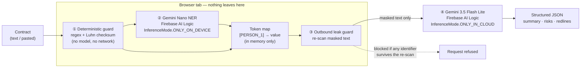

# LocalShield — privacy-first contract review with hybrid AI

**Redact on the device. Reason in the cloud.**

Every "AI contract reviewer" asks you to upload the entire agreement — names, salaries, bank
details, passport numbers — to someone else's server before it tells you that the payment
terms are bad. LocalShield inverts that: the sensitive parts are removed by a model running
*inside your browser*, and only the tokenised document ever reaches Gemini.

Built for the **Firebase #BuildHybridAI 2026** hackathon with **Firebase AI Logic hybrid
inference**: `ONLY_ON_DEVICE` (Gemini Nano via Chrome's Prompt API) for the privacy work and
`ONLY_IN_CLOUD` (Gemini 3.5 Flash Lite) for the analysis.

**Live demo:** <https://localshield-hybrid-ai.web.app> — Firebase project `localshield-hybrid-ai`,
Hosting + AI Logic (Gemini Developer API) + App Check (reCAPTCHA Enterprise). No install, no sign-in.

---

## The problem in one paragraph

A freelancer reviewing a service agreement, or an HR lead reviewing an offer letter, has no
practical way to get a second opinion at 11 pm. Uploading the document to a chatbot is the
obvious move — and it hands a stranger's model the exact data the contract is about. Legal
teams know this, so the useful AI never gets used where it matters most. LocalShield keeps the
identities on the device and sends only what a clause review actually needs: the argument.

## What it does

1. **Load** a contract (three samples included: Freelance Service Agreement, Mutual NDA,
   Employment Offer Letter — all packed with fictional PII).
2. **Redact locally.** A deterministic guard replaces emails, SSNs, EINs, passport and bank
   numbers, cards, phones, addresses, company names and money amounts with stable tokens
   (`[PERSON_1]`, `[EMAIL_2]`). Gemini Nano then reads the *already partially masked* text and
   finds what regexes cannot: people, organisations, street addresses.
3. **Guard the exit.** The masked text is re-scanned. If a single identifier-shaped string
   survived, the cloud request is blocked rather than sent.
4. **Analyse in the cloud.** Gemini returns structured JSON: a plain-language summary, the
   riskiest clauses with High/Medium/Low severity, a verbatim quote for each, and a concrete
   redline to propose.
5. **Show the receipts.** A live audit panel reports which bytes were processed locally, which
   bytes were sent, and how many — plus the exact cloud payload.

## Architecture



### Step-by-step: which model sees what

| # | Step | Inference mode | Model / engine | Input | Output | Network |
|---|------|----------------|----------------|-------|--------|---------|
| 1 | Structured redaction | *(deterministic — no model)* | 24 regex rules, Luhn/SSN validation | original document | PII spans | **none** |
| 2 | Residual entity detection | `InferenceMode.ONLY_ON_DEVICE` | Gemini Nano, Chrome Prompt API | partially masked text | `{text, category}` entities | **none** |
| 3 | Outbound leak guard | *(deterministic)* | same rules as step 1 | masked text | pass / block | **none** |
| 4 | Clause & risk analysis | `InferenceMode.ONLY_IN_CLOUD` | `gemini-3.5-flash-lite` via Firebase AI Logic | masked text | JSON (summary, clauses, redlines) | Firebase AI Logic |
| 5 | Demo / simulation | *(offline)* | 14-rule offline reviewer | masked text | same JSON shape | **none** |

### Why not `PREFER_ON_DEVICE`?

The hybrid SDK's `PREFER_ON_DEVICE` and `PREFER_IN_CLOUD` modes silently fall back to the other
side. That is the right default for a chatbot and the wrong default here:

* **Step 2 must never fall back to the cloud.** A privacy filter that "helpfully" uploads the
  document when the local model is missing is worse than no filter. `ONLY_ON_DEVICE` turns a
  missing model into a handled error, and the pipeline continues with regex-only redaction.
* **Step 4 must not fall back to the device.** The whole point of the cloud step is a model
  large enough to read a 12-page agreement; a silent downgrade to Nano would quietly produce a
  worse answer instead of an error. `ONLY_IN_CLOUD` keeps the failure visible.

The SDK still reports `response.inferenceSource` (`on_device` / `in_cloud`) for every response —
the UI shows it in the analysis header and the audit log.

## The privacy guarantee, layer by layer

1. **Deterministic before generative.** Structured identifiers never reach a model at all —
   regex plus checksums (Luhn for cards, SSN area-number rules) catch them locally in
   microseconds. This is also what makes the redaction reproducible.
2. **On-device only.** Step 2 uses `InferenceMode.ONLY_ON_DEVICE`; the SDK will not fall back to
   the cloud even when the model is missing.
3. **Leak guard.** Before any request, the masked text is re-scanned with the full rule set. Any
   hit blocks the request (and says so in the audit log).
4. **The map stays in memory.** The placeholder → value mapping lives in a React state object.
   It is never written to `localStorage`, never put in a URL, never included in a request, and
   it disappears when the tab closes. "Reveal originals" in the UI reads from that memory only.
5. **Audit by default.** Every step writes a line: what ran, on which channel
   (`device` / `cloud`), how many characters, and what was transmitted. The "Cloud payload" tab
   shows the exact bytes.

## Enabling Gemini Nano in Chrome

On-device inference needs **Chrome 139+ on desktop**.

1. `chrome://settings/help` — update Chrome.
2. `chrome://flags/#prompt-api-for-gemini-nano-multimodal-input` → **Enabled** → relaunch.
3. Confirm the model state in the DevTools console:
   ```js
   await LanguageModel.availability(); // "available" | "downloadable" | "downloading" | "unavailable"
   ```
4. If it returns `downloadable`, press **Download Gemini Nano now** in the app (or wait for the
   first request). The model is a few GB and downloads once; Firefox/Safari/mobile are not
   supported.

Without Nano the app still works: the badge says `no Prompt API`, step 2 is skipped with a
warning in the audit log, and the regex guard does the redaction. That is the honest
degradation path, and it is visible on screen.

## Firebase setup (5 minutes)

1. Create a project at <https://console.firebase.google.com> (no Analytics needed).
2. **Project settings → Your apps → Web (`</>`)** and copy the config object.
3. **Build → AI Services → AI Logic → Get started**, choose the **Gemini Developer API**
   provider. This enables the required APIs and enforces App Check for AI Logic.
4. **Security → App Check → Apps → register the web app** with **reCAPTCHA Enterprise**
   (create a site key in Google Cloud Console → reCAPTCHA Enterprise, type *Score*).
5. **Security → App Check → APIs → Firebase AI Logic → Enforce**.
6. Copy `.env.example` to `.env.local` and fill in the config plus
   `VITE_APPCHECK_SITE_KEY`.

### Local development with the App Check debug provider

```bash
# .env.local
VITE_APPCHECK_DEBUG=true      # print a debug token in the browser console
# VITE_APPCHECK_DEBUG_TOKEN=  # or paste an already-registered token here
```

Open the app, copy the `AppCheck debug token: "…"` line from the console, and register it in
**App Check → Apps → (your app) → Manage debug tokens**. Never commit a debug token, and never
call `initializeAppCheck` with the debug provider in a production build.

## Run it

```bash
npm install
cp .env.example .env.local   # optional: skip to run in simulation mode
npm run dev                  # http://localhost:5173
```

Other scripts:

```bash
npm run typecheck   # tsc --noEmit
npm run build       # typecheck + production bundle into dist/
npm run preview     # serve the production build
```

No Firebase project? The app boots in **simulation mode** — everything except the cloud call
runs for real (regex redaction, leak guard, audit log), and the analysis comes from the offline
rule set, clearly labelled `SIMULATED` in the header and the audit log.

## Deploy

### Firebase Hosting (this project's live deployment)

```bash
npm run build
firebase deploy --only hosting --project localshield-hybrid-ai
```

`firebase.json` publishes `dist/` as a single-page app (`{"source": "**", "destination": "/index.html"}`)
with immutable caching for hashed assets and `no-cache` for `index.html`. The site is
`https://localshield-hybrid-ai.web.app`; `firebase use` reads the default project from `.firebaserc`.
The build embeds the `VITE_FIREBASE_*` / `VITE_APPCHECK_SITE_KEY` values from `.env.local`, so deploy
from a machine (or CI secret set) that holds them — the values themselves never enter git.

### GitHub Pages (optional mirror)

Two ready-made workflows live in `docs/workflows-reference/`:

* `ci.yml` — typecheck + build on every push and PR.
* `deploy.yml` — builds and publishes to GitHub Pages on `main`.

They sit outside `.github/` only because the GitHub App token that published this repository is
not allowed to push workflow files. Enable them in one of two ways:

```bash
# from a clone, with a token that has the `workflow` scope
git clone https://github.com/mementomoriCarpediem/localshield-hybrid-ai.git
cd localshield-hybrid-ai && mkdir -p .github/workflows
cp docs/workflows-reference/*.yml .github/workflows/
git add .github && git commit -m "ci: enable workflows" && git push
```

or, without a local clone, use the GitHub web editor: **Add file → Create new file**, name it
`.github/workflows/deploy.yml`, and paste the contents of `docs/workflows-reference/deploy.yml`
(same for `ci.yml`). Then set **Settings → Pages → Source** to **GitHub Actions** — that one
setting is what lets `deploy.yml` publish `https://mementomoricarpediem.github.io/localshield-hybrid-ai/`.

To let the hosted demo reach your project, add `VITE_FIREBASE_*` and `VITE_APPCHECK_SITE_KEY`
as repository secrets (Settings → Secrets and variables → Actions), and add your Pages domain
to the reCAPTCHA Enterprise key's allowed domains. Without secrets the Pages demo still deploys
and runs in simulation mode.

## Project structure

```
src/
├── lib/
│   ├── config.ts      env reading, model name, "is Firebase configured?"
│   ├── firebase.ts    initializeApp + App Check (reCAPTCHA Enterprise / debug provider)
│   ├── ai.ts          firebase/ai: schemas, ONLY_ON_DEVICE + ONLY_IN_CLOUD models, calls
│   ├── pii.ts         20 deterministic detectors, overlap resolution, Luhn/SSN validation
│   ├── redact.ts      tokenisation ([PERSON_1]), masked segments, outbound leak scan
│   ├── pipeline.ts    orchestration + audit events + leak-guard block
│   └── demo.ts        offline rule-based analyst (simulation mode only)
├── components/        DocumentPanel, RedactionPanel, AnalysisPanel, AuditPanel, PipelineSteps
├── data/samples.ts    three sample contracts with fictional PII
├── types.ts
└── App.tsx
```

Key functions:

| Function | File | Purpose |
|----------|------|---------|
| `detectDeterministicPii(text)` | `lib/pii.ts` | all regex/checksum detections, overlaps resolved |
| `applyRedaction(text, spans)` | `lib/redact.ts` | stable tokens, masked text, diff segments |
| `getDeviceModel()` / `detectResidualEntitiesOnDevice()` | `lib/ai.ts` | `InferenceMode.ONLY_ON_DEVICE`, `responseConstraint` schema |
| `getCloudModel()` / `analyzeContractInCloud()` | `lib/ai.ts` | `InferenceMode.ONLY_IN_CLOUD`, `responseMimeType` + `responseSchema` |
| `initializeAppCheck()` | `lib/firebase.ts` | reCAPTCHA Enterprise provider, debug token in dev only |
| `runPipeline(text, options)` | `lib/pipeline.ts` | 4-step orchestration, audit trail, leak-guard block |
| `analyzeSimulated(text)` | `lib/demo.ts` | offline analyst (labelled, never networked) |

## Verification

Both gates are green on the committed tree (Node 26, TypeScript 7, Vite 8):

```
$ npm run typecheck     # tsc --noEmit — clean
$ npm run build         # tsc + vite build — clean, 359 kB JS / 112 kB gzipped
```

During development the redaction layer was checked against all three sample documents with a
throwaway harness: 0 residual identifiers after redaction, 0 known secret strings (SSNs, emails,
IBANs, salaries, names) in the masked output, 13–17 distinct tokens per document, and the
outbound guard cleared every masked document it produced.

## Limitations, honestly

* **English-centric.** The rule set and the sample documents are English; Korean RRNs are
  covered, but the analysis prompt and the entity detection are tuned for English contracts.
* **Nano quality varies.** The on-device pass improves recall (names, orgs, addresses) but is
  not a guarantee; the deterministic layer is what the leak guard trusts.
* **Not legal advice.** It flags issues so a human — ideally a lawyer — can act on them.
* **Chrome-only for step 2.** Filing a Chrome Web Store requirement (#1 in Devpost).

## Roadmap

* PDF/DOCX ingestion on-device (pdf.js + mammoth) so nothing needs copying and pasting.
* Persist the token map in IndexedDB with a passphrase, so a review survives a reload without
  ever syncing.
* Clause-level "diff vs. your standard paper" using `PREFER_ON_DEVICE` for the cheap pass.
* Korean contracts: 형태소-aware detectors and a Korean analysis prompt.

## License

Apache-2.0 — see [LICENSE](LICENSE).

Sample documents contain fictional people, companies and identifiers. Any resemblance to real
data is coincidental.
